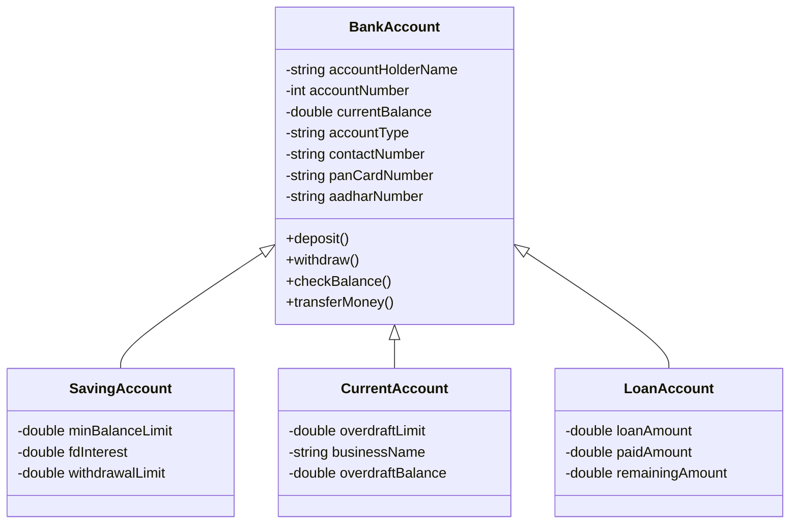
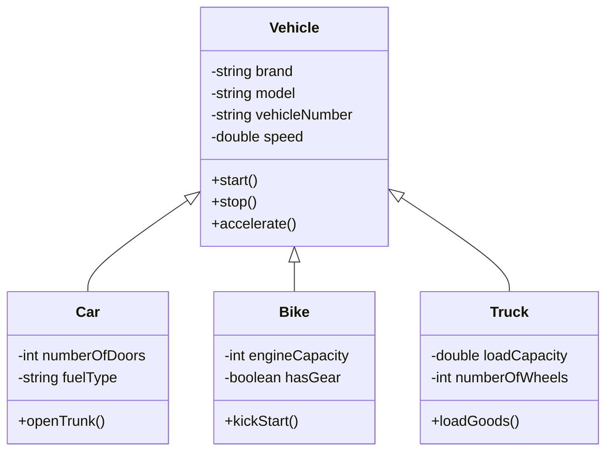
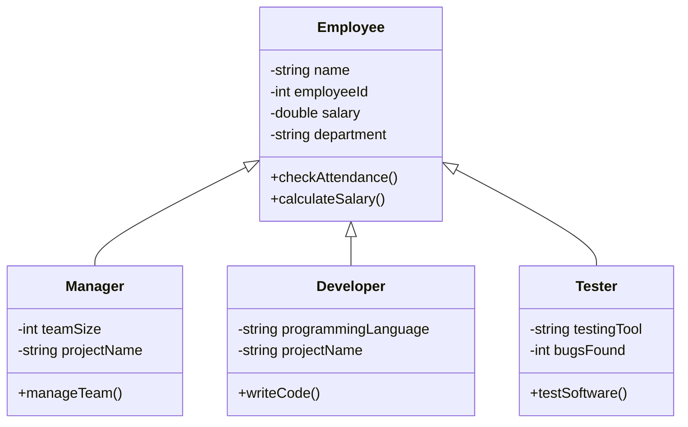
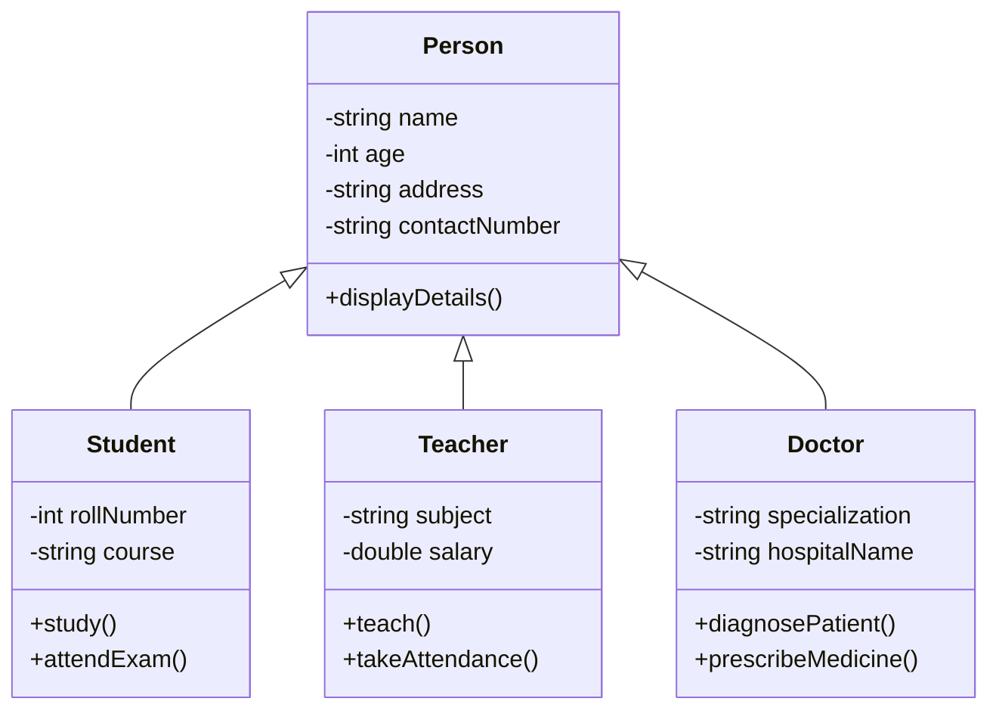
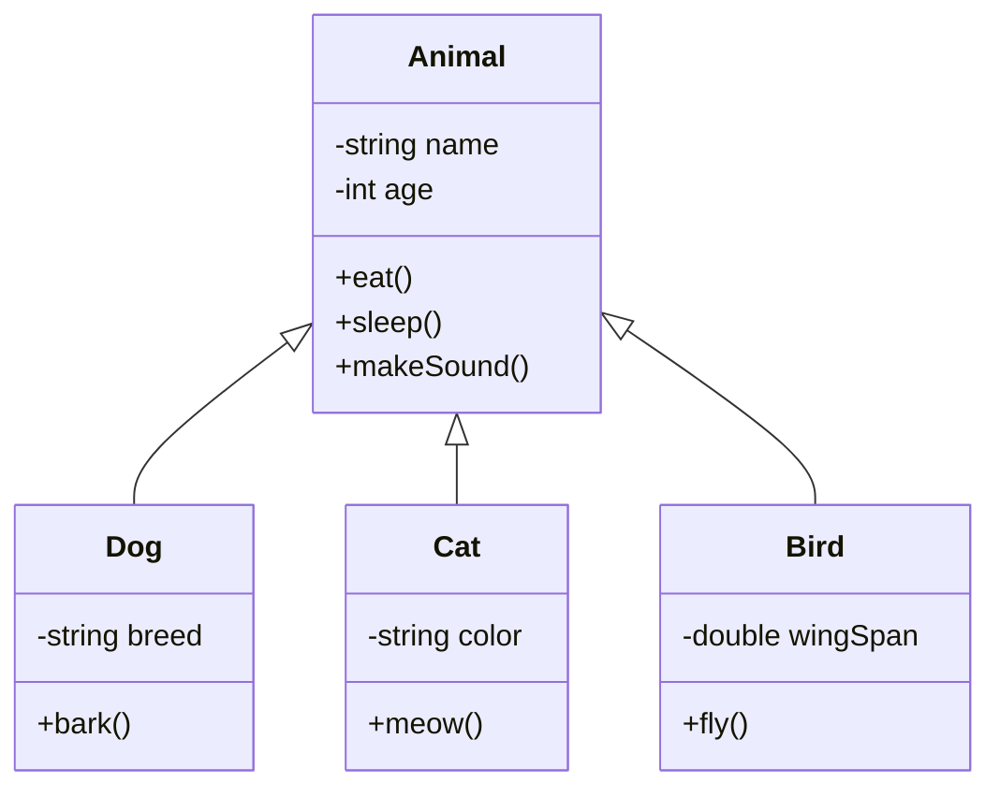
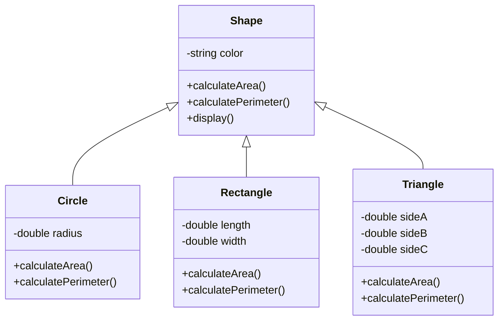
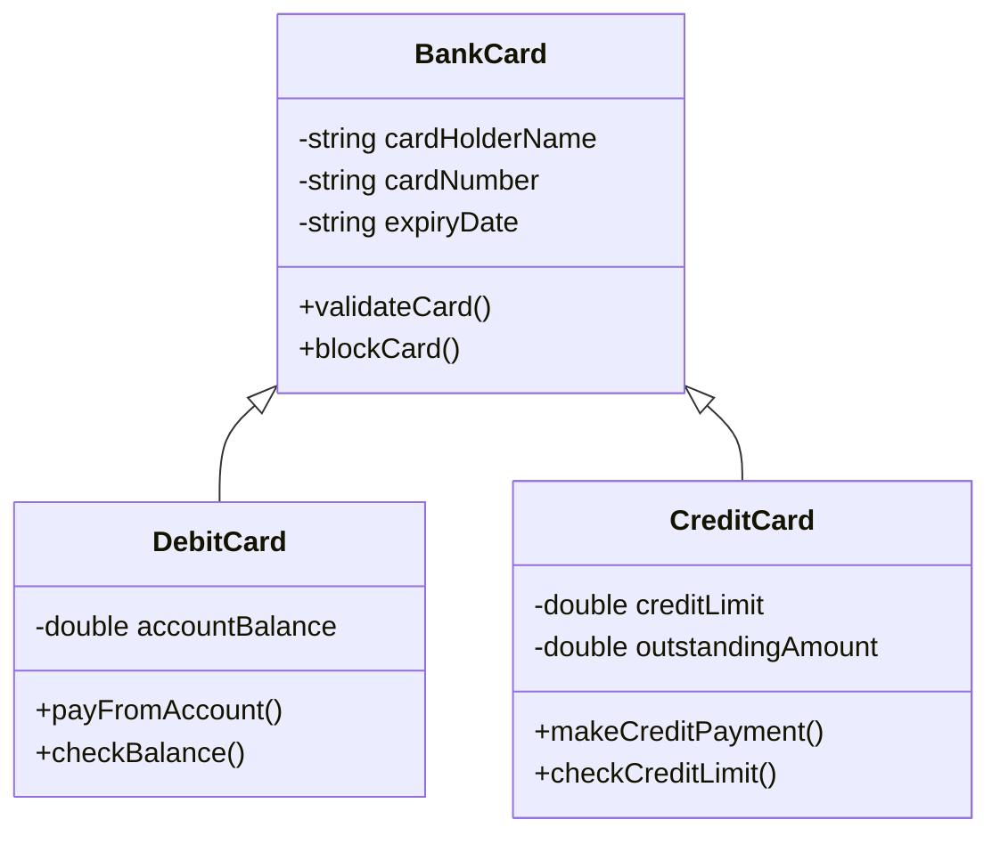
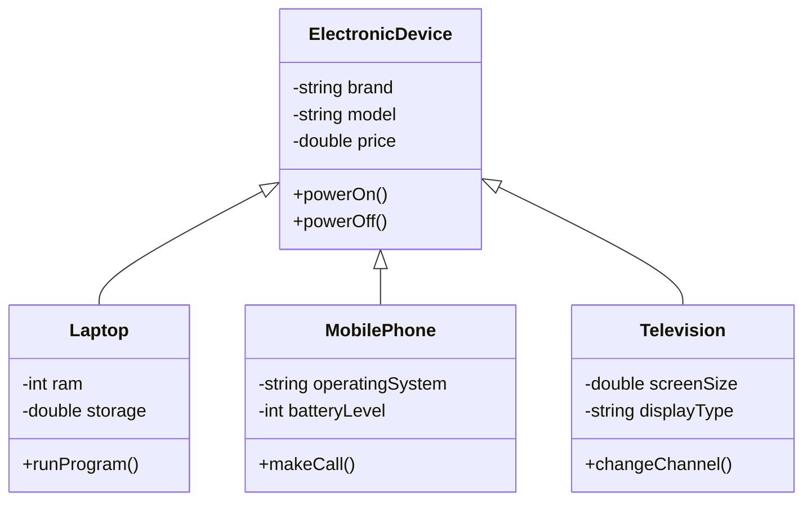
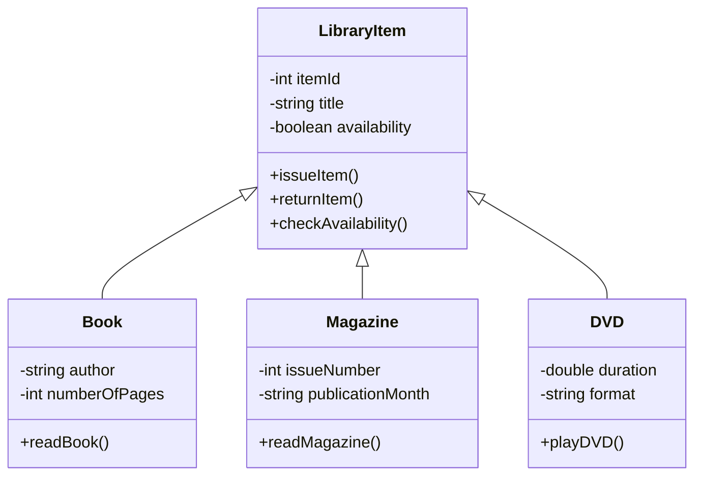
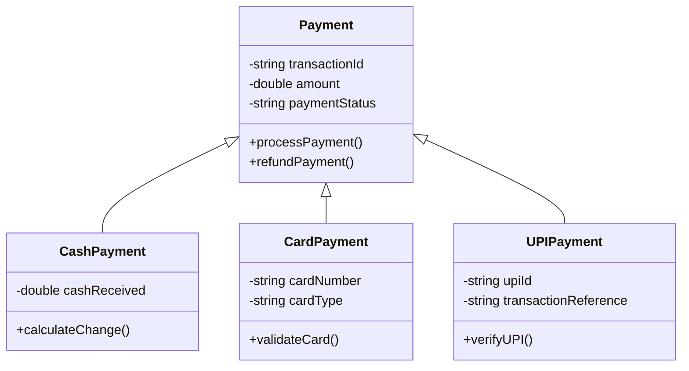

# Assignment 3: Real-Life Examples of Inheritance

## What is Inheritance?

**Inheritance** is an OOP concept in which one class acquires the properties and methods of another class.

- **Parent Class:** The class whose properties and methods are inherited.
- **Child Class:** The class that inherits properties and methods from the parent class.
- **IS-A Relationship:** A child class is a type of parent class.

---

## 1. Bank Account

A `BankAccount` is the parent class. `SavingAccount`, `CurrentAccount`, and `LoanAccount` inherit from it.

### Class Diagram

**Explanation:** All account types share common account details and operations. Each child class has its own specific attributes.

---

## 2. Vehicle

A `Vehicle` is the parent class. `Car`, `Bike`, and `Truck` inherit from it.

### Class Diagram

**Explanation:** All vehicles can start, stop, and accelerate. Cars, bikes, and trucks have their own special features.

---

## 3. Employee

An `Employee` is the parent class. `Manager`, `Developer`, and `Tester` inherit from it.

### Class Diagram

**Explanation:** All employees share common employee details. Each role has its own responsibilities and features.

---

## 4. Person

A `Person` is the parent class. `Student`, `Teacher`, and `Doctor` inherit from it.

### Class Diagram

**Explanation:** Students, teachers, and doctors are all persons, but each has different attributes and behaviors.

---

## 5. Animal

An `Animal` is the parent class. `Dog`, `Cat`, and `Bird` inherit from it.

### Class Diagram

**Explanation:** All animals eat and sleep. Different animals have their own behaviors, such as barking, meowing, or flying.

---

## 6. Shape

A `Shape` is the parent class. `Circle`, `Rectangle`, and `Triangle` inherit from it.

### Class Diagram

**Explanation:** All shapes have common operations, but each shape calculates its area and perimeter differently.

---

## 7. Bank Card

A `BankCard` is the parent class. `DebitCard` and `CreditCard` inherit from it.

### Class Diagram

**Explanation:** Both cards share common card details. A debit card uses the bank account balance, while a credit card uses a credit limit.

---

## 8. Electronic Device

An `ElectronicDevice` is the parent class. `Laptop`, `MobilePhone`, and `Television` inherit from it.

### Class Diagram

**Explanation:** All electronic devices can be turned on and off. Each device has its own special functions.

---

## 9. Library Item

A `LibraryItem` is the parent class. `Book`, `Magazine`, and `DVD` inherit from it.

### Class Diagram

**Explanation:** All library items can be issued and returned. Each type of item has its own specific information.

---

## 10. Payment

A `Payment` is the parent class. `CashPayment`, `CardPayment`, and `UPIPayment` inherit from it.

### Class Diagram

**Explanation:** All payment types share common payment operations. Each payment type has its own method of processing a transaction.

---

## Conclusion

Inheritance allows a child class to reuse the attributes and methods of a parent class. It reduces code duplication and helps organize related classes using an **IS-A relationship**.

