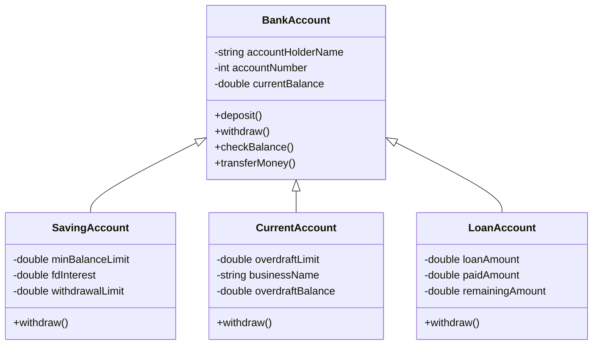
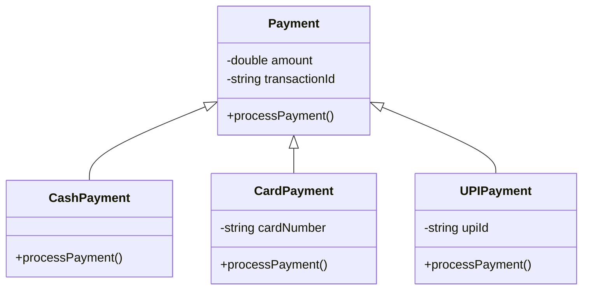
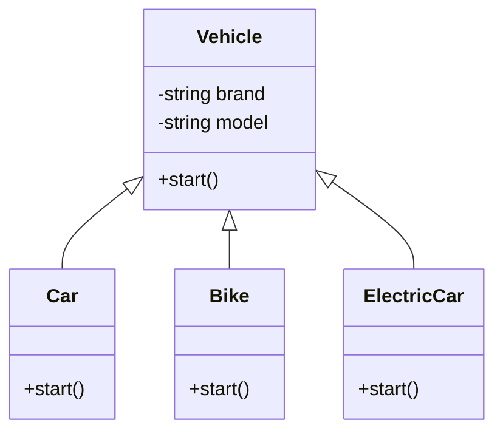
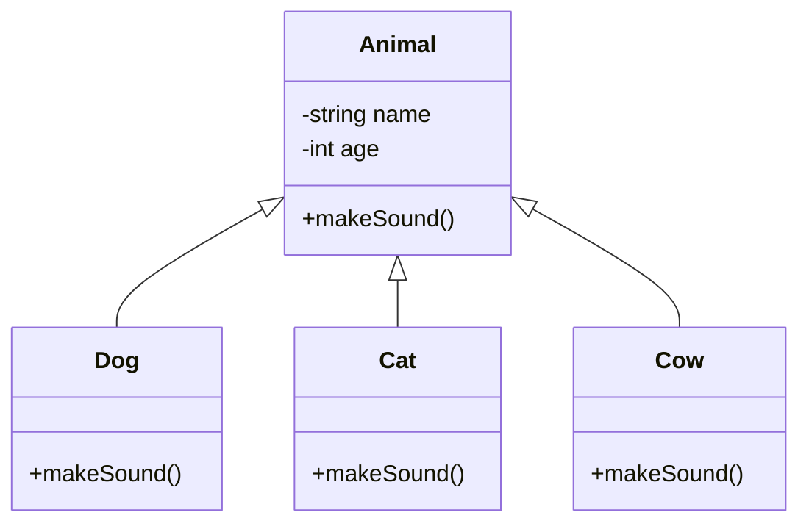
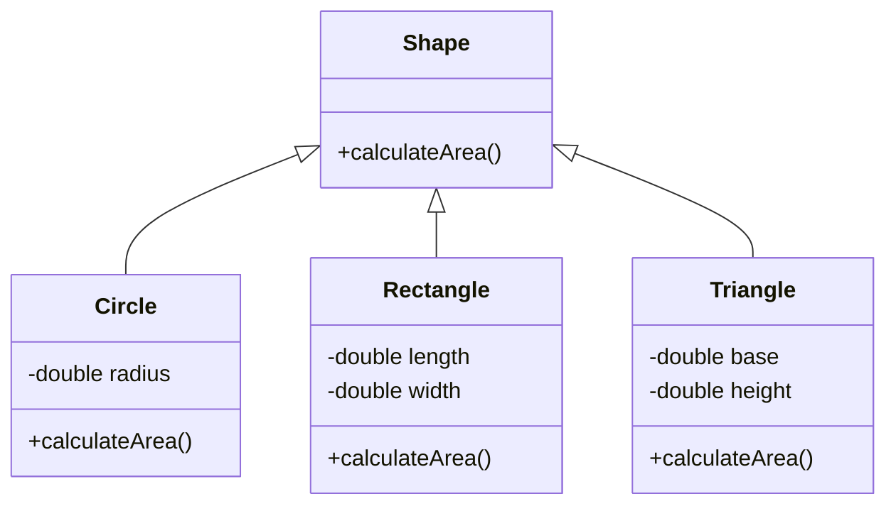
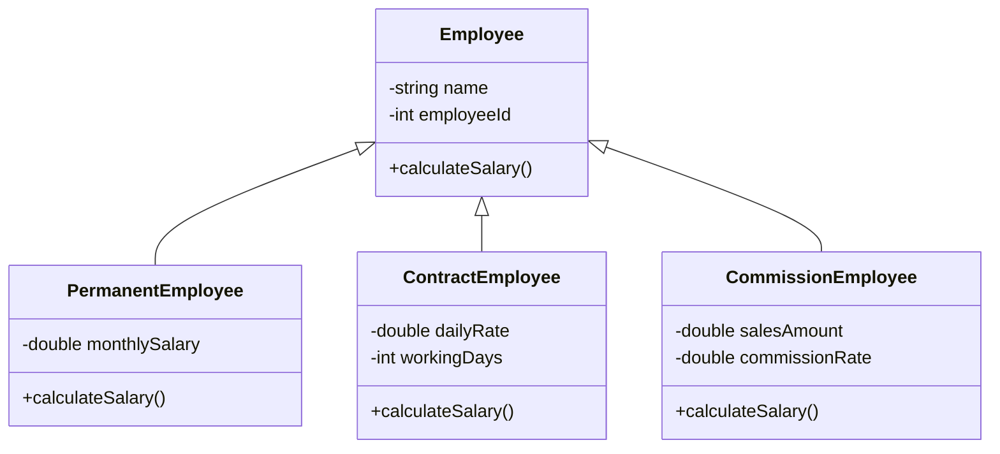
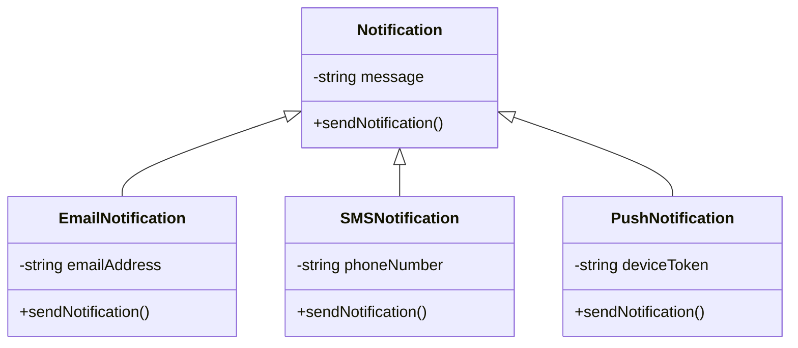
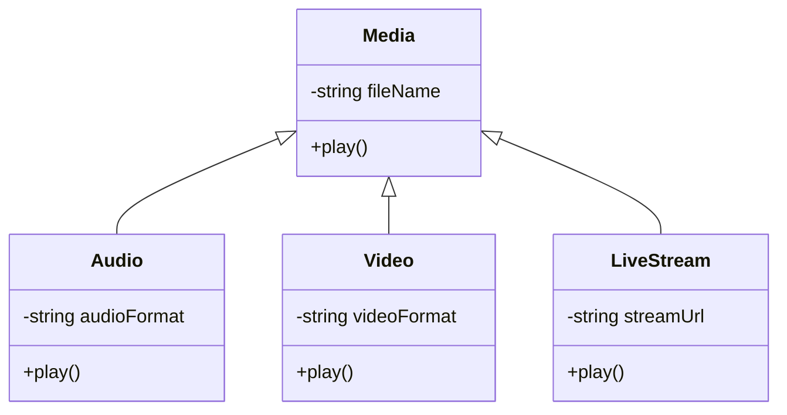
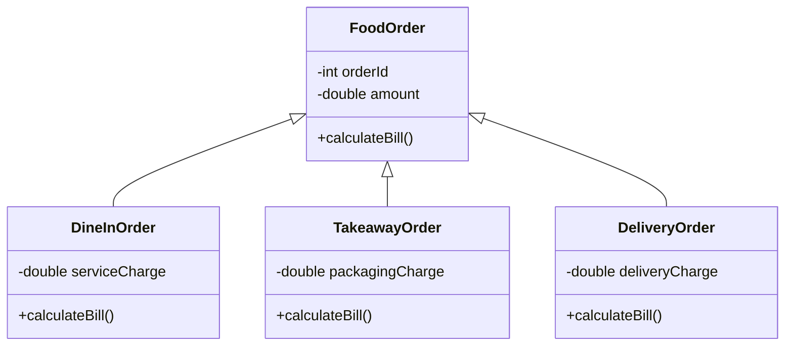
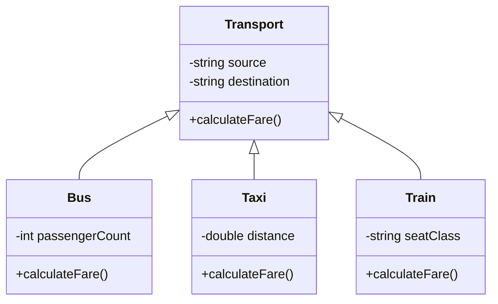

# Assignment 4: Real-Life Examples of Polymorphism

## What is Polymorphism?

**Polymorphism** is an OOP concept in which the same method or message can perform different actions depending on the object.

In simple words, **one method name can have different implementations in different classes.**

---

## 1. Bank Account

**Parent Class:** `BankAccount`  
**Common Method:** `withdraw()`

### Class Diagram

**Explanation:** The same `withdraw()` method works differently in each account type.

- **Saving Account:** Checks the minimum balance and withdrawal limit.
- **Current Account:** Checks the overdraft limit.
- **Loan Account:** Checks loan-related conditions before processing the withdrawal.

---

## 2. Payment System

**Parent Class:** `Payment`  
**Common Method:** `processPayment()`

### Class Diagram

**Explanation:** The same `processPayment()` method processes payments differently.

- **Cash Payment:** Accepts cash and calculates change.
- **Card Payment:** Verifies card details and processes the payment.
- **UPI Payment:** Verifies the UPI transaction and processes the payment.

---

## 3. Vehicle

**Parent Class:** `Vehicle`  
**Common Method:** `start()`

### Class Diagram

**Explanation:** The same `start()` method starts different vehicles in different ways.

- **Car:** Starts using its ignition system.
- **Bike:** Starts using a self-start or kick-start mechanism.
- **Electric Car:** Starts its electric motor system.

---

## 4. Animal

**Parent Class:** `Animal`  
**Common Method:** `makeSound()`

### Class Diagram

**Explanation:** The same `makeSound()` method produces different sounds.

- **Dog:** Barks.
- **Cat:** Meows.
- **Cow:** Moos.

---

## 5. Shape

**Parent Class:** `Shape`  
**Common Method:** `calculateArea()`

### Class Diagram

**Explanation:** The same `calculateArea()` method calculates the area using different formulas.

- **Circle:** Uses π × radius × radius.
- **Rectangle:** Uses length × width.
- **Triangle:** Uses ½ × base × height.

---

## 6. Employee

**Parent Class:** `Employee`  
**Common Method:** `calculateSalary()`

### Class Diagram

**Explanation:** The same `calculateSalary()` method calculates salary differently.

- **Permanent Employee:** Calculates a fixed monthly salary.
- **Contract Employee:** Calculates salary based on working days.
- **Commission Employee:** Calculates salary based on sales and commission.

---

## 7. Notification System

**Parent Class:** `Notification`  
**Common Method:** `sendNotification()`

### Class Diagram

**Explanation:** The same `sendNotification()` method sends messages through different channels.

- **Email Notification:** Sends a message through email.
- **SMS Notification:** Sends a text message to a phone.
- **Push Notification:** Sends a notification to an application.

---

## 8. Media Player

**Parent Class:** `Media`  
**Common Method:** `play()`

### Class Diagram

**Explanation:** The same `play()` method plays different types of media.

- **Audio:** Plays sound.
- **Video:** Plays video with sound.
- **Live Stream:** Plays media received in real time.

---

## 9. Food Ordering System

**Parent Class:** `FoodOrder`  
**Common Method:** `calculateBill()`

### Class Diagram

**Explanation:** The same `calculateBill()` method calculates the total bill differently.

- **Dine-In Order:** Includes service charges if applicable.
- **Takeaway Order:** Includes packaging charges if applicable.
- **Delivery Order:** Includes delivery charges if applicable.

---

## 10. Transport Booking System

**Parent Class:** `Transport`  
**Common Method:** `calculateFare()`

### Class Diagram

**Explanation:** The same `calculateFare()` method calculates fares differently.

- **Bus:** Calculates fare based on the route or ticket type.
- **Taxi:** Calculates fare based on distance and applicable charges.
- **Train:** Calculates fare based on distance and seat class.

---

## Conclusion

Polymorphism allows the same method to perform different actions depending on the object. It makes programs more flexible, reusable, and easier to maintain.

**Key Point:** Same method name, but different implementations.

